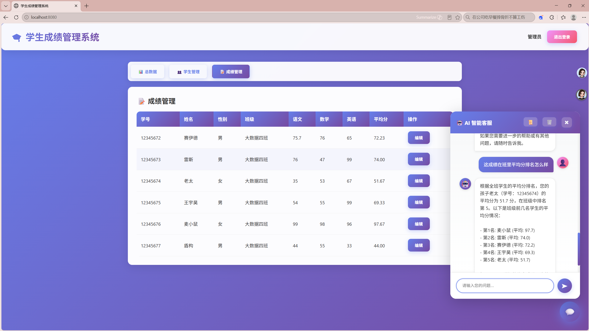

# DataTalk · 学生成绩管理 AI 助手

> 用自然语言查学生信息和成绩：老师问「张伟的数学多少分」，AI 自己决定调哪个工具、传什么参数，再把结果说成人话。

这是一个课程作业改造项目。原始系统是一套学生成绩管理后台（登录、学生/成绩 CRUD），改造的重点是**把「点菜单查数据」变成「对话查数据」**，并且把 AI 部分按工程化的方式落地：会话记忆持久化、工具调用、流式输出、会话留痕。

---

## 功能

- **自然语言查询**：学生信息、单人成绩、全班排名、班级名单、不及格名单，共 5 个 Function Calling 工具
- **多轮对话**：对话上下文存 Redis，服务重启不丢；滑动窗口保留最近 10 条，控制 Token 成本
- **流式输出**：打字机效果，首字即可见，不用等整段生成完
- **登录与鉴权**：JWT + 拦截器，密码 BCrypt 存储
- **会话留痕**：用户与 AI 的消息落库，可按会话查历史
## 演示



一次真实调用：用户问「这成绩在班里平均分排名怎么样」→ 模型判断需要查排名
→ 调用 `queryAllStudentScoresRanking()` → 按平均分降序计算名次
→ 把结果组织成带名次的中文回答，流式输出。

## 技术栈

| 层 | 选型 |
|---|---|
| 运行时 | JDK 17 / Spring Boot 3.5.7 |
| AI | Spring AI 1.1.0（OpenAI 兼容协议，默认接阿里云百炼 qwen-max） |
| 数据 | MySQL 8 + MyBatis 3.0.5 |
| 缓存 / 会话 | Redis 7（Lettuce 连接池 + Spring Session） |
| 安全 | Spring Security + JJWT 0.11.5 + BCrypt |
| 视图 | Thymeleaf + 静态页（`src/main/resources/static/index.html`） |

## 架构

```
浏览器（静态聊天页）
      │  GET /ai/chat?prompt=...&chatId=...
      ▼
ChatController ──► ChatClient
      │              ├─ ChatModel（qwen-max，OpenAI 兼容）
      │              ├─ MessageChatMemoryAdvisor ──► ChatMemory
      │              │                                  ├─ MessageWindowChatMemory（裁剪，保留 10 条）
      │              │                                  └─ RedisChatMemoryRepository（存储）
      │              ├─ SimpleLoggerAdvisor（日志）
      │              └─ AiAssistantTools（5 个 @Tool，Function Calling）
      │                        │
      │                        ├─ StudentService ──► MySQL
      │                        └─ ScoreService   ──► MySQL
      ▼
Flux<String> 流式返回 ──► 前端逐字渲染
      │
      └─ 完成后：ChatHistoryRepository 落库（Redis 会话列表 + MySQL 消息）
```

一次请求发生了什么：

1. 校验并登记 `chatId`（新会话写入 Redis Set）
2. 用户消息入库 + 入缓存
3. 组装 Prompt（系统提示词 + 最近 10 条历史 + 5 个工具定义）
4. 模型判断是否需要调用工具 → 调用 → 拿回结果 → 生成回答
5. 流式吐字，同时用 `StringBuilder` 累积完整回复
6. 流结束后把 AI 回复落库

## 快速开始

**前置**：JDK 17、MySQL 8、Redis 7

```bash
# 1. 建库建表（含默认账号 admin / admin123）
mysql -uroot -p < docker/init.sql

# 2. 配置连接（默认 localhost:3306/company，root/1234，按需修改）
#    src/main/resources/application.yml

# 3. 设置模型 Key（不要写进配置文件）
#    Windows PowerShell:  $env:DASHSCOPE_API_KEY="sk-xxx"
#    macOS / Linux:       export DASHSCOPE_API_KEY=sk-xxx

# 4. 启动
mvn spring-boot:run
# 或 docker compose up -d（MySQL + Redis + 应用一起起）
```

浏览器打开 `http://localhost:8080`，在聊天框里问：

```
张伟的数学多少分？
我们班谁不及格？
按平均分排个名
```

命令行验证流式输出（PowerShell）：

```powershell
curl.exe -N -G "http://localhost:8080/ai/chat" `
  --data-urlencode "prompt=张伟的数学多少分" `
  --data-urlencode "chatId=test-001"
```

## 三个设计取舍（面试可以展开讲）

**1. 会话记忆为什么放 Redis，而不是放内存**

Spring AI 1.1 把「存储」和「裁剪」拆成了两层：`ChatMemoryRepository` 只负责读写全量消息，`MessageWindowChatMemory` 负责按窗口裁剪。所以我只实现了存储层 `RedisChatMemoryRepository`，裁剪逻辑完全复用框架的，Controller 一行都不用改。

代价：每次对话多两次 Redis 往返；Redis 挂了对话记忆就不可用（当前没有降级到内存）。

**2. 工具为什么返回「人话」而不是 JSON**

`@Tool` 方法的返回值直接进模型上下文。返回 `"学号: 1001, 姓名: 张伟, 语文: 88.0 分"` 这种文本，模型复述准确率更高。

代价：前端拿不到结构化数据，想做排行榜图表就得再解析文本——这是当前的欠账。

**3. 为什么 Security 放行 `/ai/**`，却又有 LoginInterceptor**

项目同时存在「静态页直出」和「前后端分离接口」两套路径，Spring Security 管不了静态页里的跳转，所以把 JWT 校验交给了拦截器，Security 只做兜底。

代价：权限规则散在两个地方，新增接口容易漏配——这是历史包袱，正确做法是统一到一处。

## 已知问题与下一步

诚实列一下这个项目还没做好的地方：

- [ ] **工具内部是全表查再内存过滤**（`getAllStudents().stream()`），数据量上千就该下推到 SQL
- [ ] **没有评测集**：回答准不准全靠肉眼，没法量化
- [ ] **没有 RAG**：文档/知识库问答还没做
- [ ] **没有 Text2SQL**：复杂统计只能靠写死的工具，问不了开放性问题
- [ ] **没有可观测**：每次请求的 token 消耗、耗时、费用都没记录
- [ ] **单元测试覆盖率为 0**
- [ ] 会话记忆没有降级方案（Redis 不可用时直接报错）

下一步按这个顺序补：评测集（100 条）→ trace 与成本统计 → RAG 检索 → Text2SQL + 安全校验。

## 目录结构

```
src/main/java/com/itheima/webhomework
├── ai/tool/            # 5 个 Function Calling 工具
├── config/             # ChatClient / ChatMemory / Redis / Security 配置
├── controller/         # 聊天、登录、学生、成绩、会话历史
├── entity/ vo/         # 实体与视图对象
├── mapper/ repository/ # MyBatis Mapper 与聊天历史仓储（内存 / Redis 两版）
├── security/           # JWT 工具与登录拦截器
└── service/            # 业务层
docker/init.sql         # 建库建表 + 默认账号
docker-compose.yml      # MySQL + Redis + 应用
```

## 说明

表名带 `_web_assignment` 后缀是课程作业留下的历史命名，功能上与普通教学管理系统一致；默认账号 `admin / admin123` 仅用于本地演示，部署前必须改掉。
